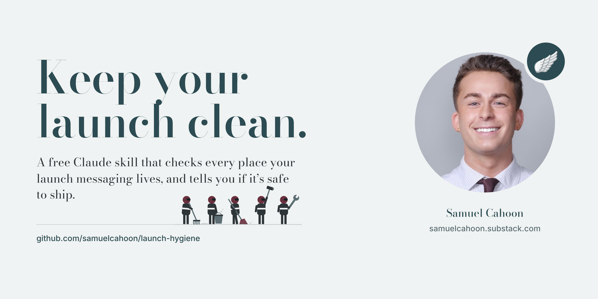

<p align="center"></p>

# Keep your launch clean 🪽

`launch-hygiene` is a Claude skill that checks your launch messaging everywhere it lives and tells you if it's safe to ship. It works for one PMM on Notion, or for a whole company on GitHub.

Most marketing skills help Claude write more. This one checks what you already wrote.

**[Download launch-hygiene.zip](https://github.com/samuelcahoon/launch-hygiene/releases/latest/download/launch-hygiene.zip)** · [Install](#install) · [Does it work?](#does-it-work) · [The eval](eval/)

## Why I built it

I was the only PMM on a launch. One line of messaging changed four times in five days, and every change had to land in eight places: the site, the founders' Notion page, the brand guide, the messaging doc, the press kit, Slack drafts, emails, and the AI tools that write in my voice. I missed one. An email went out with yesterday's version.

Nobody puts this in the job description, but when you're the only PMM, it's the job: version control for words. AI makes it harder, because now you can write the wrong sentence faster and in more places.

## What it does

Three habits, run by Claude:

1. **A canon.** Every approved line, every retired phrase, the claims you're allowed to make, and every place the messaging lives with its owner. A drift check reads your files, live pages and Notion pages and lists anything stale.
2. **A push queue.** Edits to pages other people own wait on one Notion page with the exact before and after. You say "push" once. If someone changed the line since, their edit wins and the row comes back to you.
3. **An outbox.** The current version of every message waiting to go out. It wins over the stale draft sitting in Slack.

Every run ends with a verdict. This one is from a test run on a synthetic company, after Claude had fixed everything the PMM owned:

```
Not yet. 16 stale (listed above), 5 edits queued, 5 messages waiting, 5 questions for you.
```

## What it catches that find-and-replace misses

- Old lines in meta descriptions, Open Graph tags, JSON-LD, alt text and llms.txt: the text AI answers and link previews read
- "your ai teammate" when the canon says "Your AI teammate," and you'll typed with a straight apostrophe instead of a curly one
- Near misses of an approved line, like "Every action on record" when the line is "Every action on the record"
- Claims that were never approved, or are past their review date
- AI prompts and skills that still hold an old line. These come first in the report, because they write tomorrow's copy.

It skips what it should (Never lists, changelogs, archive folders) and lists every line it skipped, so nothing is hidden.

## For a whole team: put the canon on GitHub

Ina Toncheva's ["Your marketing team will be on GitHub within a year"](https://inatoncheva.substack.com/p/your-marketing-team-will-be-on-github) makes the case: AI work runs on files that depend on each other (positioning feeds voice, voice feeds every writing skill), and those files need a history, a way back, and a home that doesn't belong to one AI vendor. A shared repo gives you all three.

This skill adds the step that turns a shared folder into company-wide alignment:

- The canon lives in a private repo with the positioning, voice and objection files and the AI instructions that write copy. Everyone's Claude reads the same files.
- Every messaging change is a pull request, and the person who decides that line approves it (`CODEOWNERS`).
- The drift check runs on every pull request and fails it if an old line is still in the copy.
- Something wrong? Revert the pull request.
- People who never open GitHub still read the Notion copy, updated after each merge.

The setup (folder layout, approval file and the check) is in [`skills/launch-hygiene/templates/github/`](skills/launch-hygiene/templates/github/).

## What it won't do

- Write to a page someone else owns until you say "push"
- Send anything. You send.
- Overwrite someone's newer edit to match the canon
- Pick a winner when two people disagree on a line
- Rewrite history: sent messages, customer quotes, old changelog lines, published releases, legal text
- Say "safe to ship" about anything it didn't check

## Does it work?

I test my skills on a synthetic company with mistakes planted on purpose, then grade the run. The eval here builds a fake launch week: eight surfaces, a tagline that changed four times, a renamed product, a launch date that moved, 15 planted mistakes and 5 traps. One trap is a customer quote that uses a banned word: a good run asks about it instead of editing someone's words. Claude runs the skill blind, without the answer key.

| Run | Synthetic company | Planted mistakes found | Traps | Verdict |
| --- | --- | --- | --- | --- |
| v1, blind | Northlight AI | 14.5 of 15 | One slip: edited an old changelog line | Right |
| v2, blind | Harborline | 15 of 15 | Clean | Right |
| v2.1, blind | Northlight AI again | 15 of 15 | Clean | Right |

v1's run only got there because Claude checked four things by hand that the script missed. Five independent reviews found the same gaps, so v2 rewrote the script.

The script on its own, on both launch weeks: the first version flagged 24 of 29 stale phrases. This version flags 29 of 29, with no false alarms on the traps.

The full results, the week generator and the grader are in [eval/](eval/), so you can rerun the test or point it at your own version of the skill. The script benchmark also runs on every push to this repo.

## Install

**Claude (web or desktop)**

1. Download [launch-hygiene.zip](https://github.com/samuelcahoon/launch-hygiene/releases/latest/download/launch-hygiene.zip).
2. Turn on code execution: Settings, Capabilities, "Code execution and file creation." On a Team or Enterprise plan, an owner turns on skills for the organization.
3. In Claude, go to Customize, then Skills. Select +, then Create skill, then Upload a skill, and pick the zip.
4. Connect Notion, so Claude can read your pages and make the canon, push queue and outbox pages.

[Anthropic's instructions for skills](https://support.claude.com/en/articles/12512180-use-skills-in-claude)

**Claude Code**

Copy `skills/launch-hygiene` into `~/.claude/skills/`, or run `npx skills add samuelcahoon/launch-hygiene`.

Setup takes about 15 minutes. Start with tonight's change: one approved line and the phrase it replaces is enough.

## Use it

- "Set up launch hygiene for our launch. The tagline is now X. It used to be Y."
- "We renamed X to Y. Drift check everything."
- "Drift check `https://yoursite.com` and our Notion launch page."
- "Queue this for the founder page." Then later: "Push."
- "Put this in the outbox."
- "Are we safe to ship?"

## Files

| Path | What it is |
| --- | --- |
| `skills/launch-hygiene/SKILL.md` | What Claude follows |
| `skills/launch-hygiene/drift_check.py` | The check (Python 3, nothing to install). Reads files, never edits them |
| `skills/launch-hygiene/canon.example.json` | Every canon field, with placeholders |
| `skills/launch-hygiene/templates/` | The canon, push queue and outbox pages for Notion |
| `skills/launch-hygiene/templates/github/` | The team setup: repo layout, `CODEOWNERS` and the drift check for pull requests |
| `eval/` | The synthetic launch weeks, the grader and the results |

## Credit

Built by Sam Cahoon, [Super PMM 🪽](https://samuelcahoon.substack.com), in October 2026, from running a launch as the only PMM. The eval follows how I test every skill: plant the mistakes first, then write the files that hide them.

MIT license. If it catches something for you, tell me which line it was.
